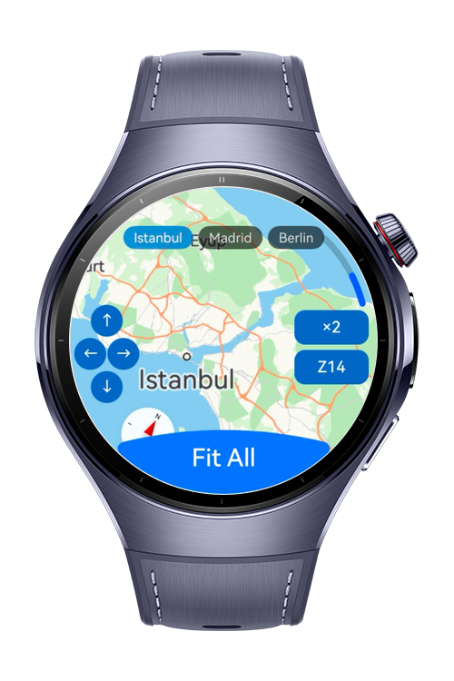
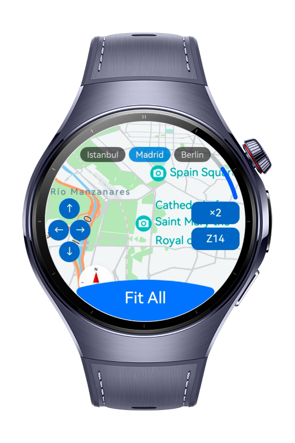
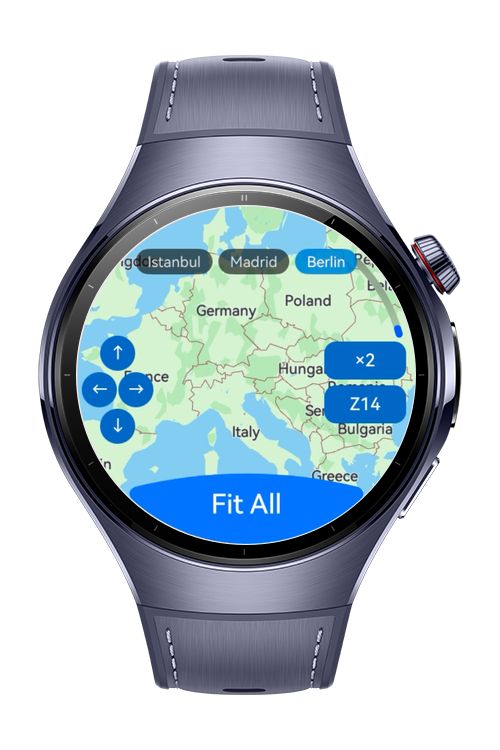

> **Note:** To access all shared projects, get information about environment setup, and view other guides, please visit [Explore-In-HMOS-Wearable Index](https://github.com/Explore-In-HMOS-Wearable/hmos-index).

# How to Build Map Camera Zoom
This codelab demonstrates how to control the **map camera** on a HarmonyOS wearable device using MapKit. The watch app renders a full-screen map centred on Europe and exposes every major camera control API through a minimal overlay UI and the Digital Crown  letting developers see exactly how each method affects the camera in real time.

# Preview

<div>
  
  
  
</div>

# Use Cases

- **Fly to a location** — tap a city chip to animate the camera to Istanbul, Madrid, or Berlin using `newCameraPosition()` with a custom tilt and bearing.
- **Frame multiple points** — tap "Fit All" to automatically frame all three cities within the visible map region using `newLatLngBounds()`.
- **Incremental zoom** — rotate the Digital Crown to zoom in or out one level at a time using `zoomIn()` and `zoomOut()`.
- **Relative zoom** — tap "×2" to zoom in by two levels relative to the current position using `zoomBy()`.
- **Absolute zoom** — tap "Z14" to jump directly to zoom level 14 using `zoomTo()`.
- **Pan the map** — tap the directional arrow buttons to scroll the map by a fixed pixel offset in any direction using `scrollBy()`.
- **Animation feedback** — every animated camera move returns an `AnimateResult` via `animateCameraStatus()`, and the result ("Finished" or "Cancelled") is shown as a brief toast.

# Technology

## Stack

- **Languages:** ArkTS
- **Frameworks:** HarmonyOS SDK, API version 18+
- **Tools:** DevEco Studio 6.0.1 or later
- **Libraries & Kits:**
    - `@kit.MapKit` — `MapComponent`, `MapComponentController`, `map.newCameraPosition`, `map.newLatLngBounds`, `map.zoomIn`, `map.zoomOut`, `map.zoomTo`, `map.zoomBy`, `map.scrollBy`, `map.AnimateResult`
    - `@kit.ArkUI` — `ArcButton`, `ArcButtonOptions`, `ArcButtonPosition`, `ArcButtonStyleMode`
    - `@kit.PerformanceAnalysisKit` — `hilog`
    - `@kit.BasicServicesKit` — `AsyncCallback`

## Required Permissions

| Permission | Reason |
|---|---|
| `ohos.permission.INTERNET` | Required by MapKit to load map tiles from Huawei map servers |

> Map Kit must be enabled in AppGallery Connect. All landmark coordinates are hardcoded.

# Directory Structure

```
entry/src/main/ets/
├── constants/
│   └── Constants.ets          # zoom levels, offsets, durations
├── entryability/
│   └── EntryAbility.ets    
├── model/
│   └── LandmarkData.ets       # Hardcoded landmarks and bounds
└── pages/
    └── Index.ets              # Full-screen map, all camera controls, Crown handler

entry/src/main/resources/base/
├── element/
│   ├── color.json             # All color tokens
│   └── string.json            # All string resources
└── profile/
    └── main_pages.json
```

# Constraints and Restrictions

## Supported Devices

- Huawei Watch 5

# License

**How to Build Map Camera Zoom** is distributed under the terms of the MIT License.
See the [LICENSE](./LICENSE) for more information.
